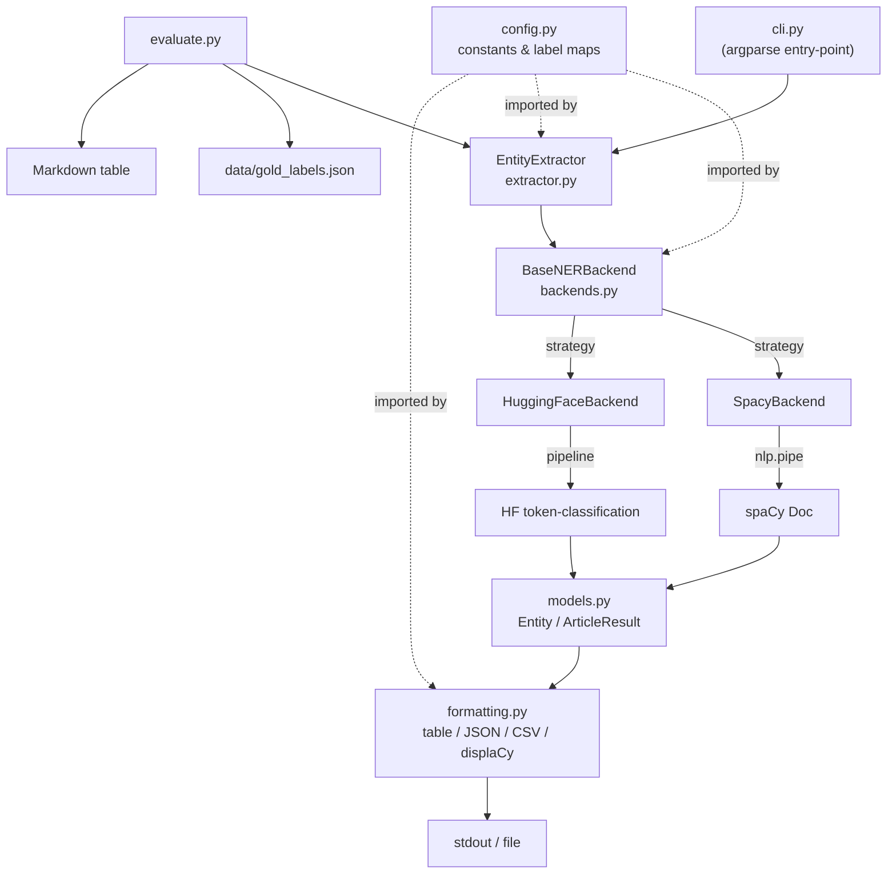

# NER Parser — Production-Quality Named Entity Recognition Pipeline

> Extract **Dates**, **Locations**, and **Organizations** from news article
> snippets using spaCy (default) or HuggingFace Transformers.


---

## Problem Statement

News articles contain a wealth of structured information — people, places,
organisations, and time references — embedded in unstructured text. Extracting
these entities reliably at scale is a foundational task in information retrieval,
knowledge graph construction, and event monitoring.

This project implements a **production-ready NER pipeline** that:

1. Loads 5 realistic news snippets from a JSON data file (no hardcoded strings).
2. Runs NER using either spaCy (`en_core_web_sm` / `en_core_web_trf`) or a
   HuggingFace transformer model (`dslim/bert-base-NER`).
3. Deduplicates entities case-insensitively while preserving character offsets.
4. Outputs results as a human-readable table, JSON, or CSV.
5. Evaluates model quality against hand-labelled gold data.

---
## Approach

### Model choice
I used spaCy's `en_core_web_sm` as the default model because it tags DATE, GPE/LOC and ORG out of the box and runs quickly on a CPU, which suits short news snippets. To check whether a larger or different model would do better, I compared it against spaCy's `en_core_web_trf` (transformer-based) and the Hugging Face model `dslim/bert-base-NER`. The Hugging Face model was trained on CoNLL-2003, which has no DATE class, so it can only be compared on Locations and Organizations.

### Label mapping
The task asks for three categories, so I mapped model labels to them in `config.py`: DATE → Dates, ORG → Organizations, and both GPE and LOC → Locations. spaCy uses GPE for countries, cities and states, and LOC for other places such as regions and bodies of water. A news reader would treat both as "locations", so merging them matches the task. Keeping the mapping in one configurable place means it can be changed without touching the pipeline code.

### Post-processing
Models often return the same entity several times in one snippet, so I deduplicate entities per article, case-insensitively, keeping the first occurrence. Each entity keeps its character offsets (`start`, `end`) so results can be traced back to the source text and highlighted, for example with displaCy. Output order follows the position in the text.

### Design decisions
- **Backend abstraction:** spaCy and Hugging Face sit behind a common `BaseNERBackend` interface (strategy pattern). The extractor, formatter and evaluator don't depend on which model is used, so adding a model means adding one class.
- **Data outside the code:** the 5 snippets and the gold labels live in JSON files under `data/`, not in the source.
- **CLI:** an `argparse` command-line interface selects the backend, model, input file and output format (table, JSON or CSV), so the same code serves quick runs and reproducible exports.
- **Separation of concerns:** configuration, data models (dataclasses), extraction, formatting and evaluation are separate modules, each covered by tests. Results go to stdout and logs go to stderr, so output can be piped or saved cleanly.
- **Batch processing:** `nlp.pipe()` is used for efficient processing of multiple articles.

### Evaluation
I hand-labelled the entities in the 5 snippets (`data/gold_labels.json`) and score each backend with precision, recall and F1 per category. Matching is case-insensitive exact match on the entity text, counted per article and category, then aggregated across articles. I chose exact match because it is simple, transparent and easy to reproduce. Annotation rules:  relative expressions such as "last Friday" count as dates, and an entity's gold label is the span a reader would copy, without articles like "the"

### Trade-offs and limitations
- **Strict matching:** exact match penalises boundary differences. If the model returns "since January 2023" and the gold label is "January 2023", it counts as both a false positive and a false negative even though the model found the date. 
- **Small sample:** with only 5 snippets and [N] gold entities, a single error moves the scores noticeably, so the numbers are indicative rather than statistically reliable.
- **Set-based scoring:** because entities are deduplicated, repeated mentions in one snippet are counted once.
- **Pretrained models only:** I did not fine-tune on news data, so domain gaps show up as errors. Locations were mostly missed. The model found 3 of 8 gold locations (recall 0.38), with no false positives. Organizations had too many false positives. 5 false positives against 1 miss (precision 0.55).

## Architecture



---

## Project Layout

```
ner_parser/
├── src/
│   └── ner_parser/
│       ├── __init__.py        # Public API: EntityExtractor, Entity, ArticleResult
│       ├── __main__.py        # python -m ner_parser
│       ├── config.py          # Label maps, model names, constants
│       ├── models.py          # Dataclasses: Entity, ArticleResult
│       ├── backends.py        # BaseNERBackend, SpacyBackend, HuggingFaceBackend
│       ├── extractor.py       # EntityExtractor facade
│       ├── formatting.py      # Table, JSON, CSV, displaCy renderers
│       └── cli.py             # argparse CLI
├── data/
│   ├── sample_articles.json   # 5 news snippets (input data)
│   └── gold_labels.json       # Hand-labelled gold set
├── tests/
│   └── test_extractor.py      # pytest suite (30 tests)
├── outputs/                   # displaCy HTML exports land here
│   └── .gitkeep
├── evaluate.py                # Precision / recall / F1 comparison
├── pyproject.toml
├── requirements.txt
├── Makefile
├── .gitignore
└── .github/
    └── workflows/
        └── ci.yml
```

---

## Setup

### Prerequisites

- Python 3.10+
- `pip`

### 1 — Install

```bash
# From inside the ner_parser/ directory
pip install -e ".[dev]"
python -m spacy download en_core_web_sm
```

### 2 — (Optional) Transformer models

```bash
# Large spaCy model for higher accuracy
python -m spacy download en_core_web_trf

# HuggingFace backend (requires torch)
pip install -e ".[dev,hf]"
```

---

## Usage

### Run with defaults (table output)

```bash
python -m ner_parser
# or
make run
```

### Specify format

```bash
python -m ner_parser --format json
python -m ner_parser --format csv --output outputs/results.csv
```

### Use a different model

```bash
python -m ner_parser --model en_core_web_trf
```

### HuggingFace backend

```bash
python -m ner_parser --backend hf --model dslim/bert-base-NER
```

### Save displaCy HTML visualisations

```bash
python -m ner_parser --displacy
# → outputs/article_00_ner.html … article_04_ner.html
```

### Full CLI reference

```
usage: ner_parser [-h] [--backend {spacy,hf}] [--model MODEL]
                  [--input INPUT] [--format {table,json,csv}]
                  [--output OUTPUT] [--displacy] [--verbose]
```

---

## Sample Output

The following is the **exact, unedited output** of
`python -m ner_parser --input data/sample_articles.json --format table`
running `en_core_web_sm` (3.8.0) on the 5 sample articles.
Articles are 0-indexed throughout (matching `article_id` in the JSON output).

```
--------+----------------+------------------------------------------+--------+-------
Art#   | Category       | Entity                                   | Start  |   End
--------+----------------+------------------------------------------+--------+-------
0      | Organizations  | The Reserve Bank of India                | 0      |    25
       | Dates          | last Friday                              | 48     |    59
       | Dates          | January 2023                             | 135    |   147
--------+----------------+------------------------------------------+--------+-------
1      | Organizations  | Amazon                                   | 0      |     6
       | Organizations  | Pune                                     | 63     |    67
       | Organizations  | Hyderabad                                | 69     |    78
       | Organizations  | Chennai                                  | 84     |    91
       | Dates          | March 2025                               | 95     |   105
--------+----------------+------------------------------------------+--------+-------
2      | Dates          | 15 August 2023                           | 3      |    17
       | Locations      | New Delhi                                | 85     |    94
       | Organizations  | ISRO                                     | 133    |   137
       | Organizations  | DRDO                                     | 142    |   146
       | Dates          | the past decade                          | 152    |   167
--------+----------------+------------------------------------------+--------+-------
3      | Organizations  | Tesla                                    | 0      |     5
       | Organizations  | Volkswagen                               | 10     |    20
       | Dates          | quarterly                                | 42     |    51
       | Dates          | yesterday                                | 59     |    68
       | Locations      | Shanghai                                 | 116    |   124
--------+----------------+------------------------------------------+--------+-------
4      | Organizations  | Amazon                                   | 13     |    19
       | Locations      | Brazil                                   | 48     |    54
       | Dates          | last Tuesday                             | 72     |    84
       | Organizations  | Amazon Web Services                      | 118    |   137
--------+----------------+------------------------------------------+--------+-------
```

---

## Evaluation Results

> **Generated with:** `python evaluate.py --backends sm --errors`
> (en_core_web_sm 3.8.0, spaCy 3.8.x, Python 3.11.4).
>
> **Scoring rule:** case-insensitive exact text match, deduplicated per
> article and category, micro-averaged across articles.
> `pred.strip().lower() == gold.strip().lower()` is the only match
> criterion — no token overlap or containment.
> This penalises broad spans: *"The Reserve Bank of India"* does not match
> gold *"Reserve Bank of India"* even though it contains it.
>
> **Small gold set caveat:** 7 Dates, 8 Locations, 7 Organizations across
> 5 articles. A single TP/FP difference moves a metric by ~0.08–0.15.
> Treat these as indicative of model behaviour on this domain, not as
> statistically robust benchmarks.

| Category | Support (gold) | spacy:en_core_web_sm<br>P / R / F1 (TP / FP / FN) |
|:---|:---:|:---:|
| Dates | 7 | 0.88 / 1.00 / 0.93 (7 / 1 / 0) |
| Locations | 8 | 1.00 / 0.38 / 0.55 (3 / 0 / 5) |
| Organizations | 7 | 0.55 / 0.86 / 0.67 (6 / 5 / 1) |
|---|---|---|
| **Micro-avg** | | 0.73 / 0.73 / 0.73 |

> For a three-way comparison including `en_core_web_trf` and
> `dslim/bert-base-NER`, run `make evaluate-all` (additional installs
> required). The HuggingFace model's Dates cell renders as `n/a` — not
> `0.00` — because the model declares it does not support that category
> via `supported_categories`.

---

## Limitations and Error Analysis

All observations come directly from `python evaluate.py --backends sm --errors`.
Each entry names the article index (0-based), category, and exact normalised
strings from the error dump.

### Article 0 | Organizations — leading "The" breaks exact match

```
FP: `the reserve bank of india`
Missed: `reserve bank of india`
```

The model spans *"The Reserve Bank of India"* including the leading article.
After lowercasing, `"the reserve bank of india" ≠ "reserve bank of india"`.
This is a span boundary issue, not a labelling error: the entity type is
correct but the offsets extend one token too far left. A normalisation step
that strips leading determiners, or a lenient containment-match mode, would
resolve it.

### Articles 1 + 4 | Locations / Organizations — city names and "Amazon" mis-labelled

```
Article 1 | Locations — Missed: `chennai`, `hyderabad`, `pune`
Article 1 | Organizations — FP: `chennai`, `hyderabad`, `pune`
Article 4 | Locations — Missed: `amazon`
Article 4 | Organizations — FP: `amazon`
```

This is the dominant error and the reason Locations recall is 0.38
(3 of 8 gold locations found). Three Indian cities and the river-town
*Amazon* were each tagged `ORG` instead of `GPE`/`LOC`. `en_core_web_sm`
is trained on OntoNotes, which under-represents Indian geography; the model
resolves city names by grammatical context (*"centres in X"*) rather than
geographic knowledge. *Amazon* is overwhelmingly associated with the
company in the training corpus. A custom `EntityRuler` pattern list for
major Indian cities would recover most of these with zero retraining.

### Article 2 | Locations — Red Fort not tagged at all

```
Missed: `red fort`
```

The model did not produce any entity for *"Red Fort"*, so it does not appear
in any category bucket. The compound landmark is absent from OntoNotes's
geographic entity distribution. 1 FN in Locations.

### Article 3 | Dates — "quarterly" is a spurious DATE

```
FP: `quarterly`
```

The adverb *"quarterly"* in *"record quarterly losses"* was tagged as DATE.
This is a known over-trigger for spaCy's statistical DATE recogniser when
frequency adverbs appear adjacent to financial-event nouns. 1 FP in Dates,
reducing Dates precision from 1.00 to 0.88.

### HuggingFace model — no DATE support, rendered as n/a not 0.00

`dslim/bert-base-NER` is fine-tuned on CoNLL-2003, which has no DATE class.
The `supported_categories` attribute on `HuggingFaceBackend` declares this
explicitly, so the evaluator skips the Dates loop entirely and the cell renders
as `n/a`. Without this guard the previous version of the code would have
iterated over Dates, found TP=FP=FN=0, and printed `0.00 / 0.00 / 0.00`,
which implies the model tried and failed rather than simply not supporting
that category.

---

## Future Work

| Theme | Approach |
|---|---|
| **Fine-tune on news data** | Use Prodigy or Label Studio to annotate a domain-specific corpus, then fine-tune via `spacy train` or a BERT token-classification head. |
| **Custom EntityRuler rules** | Add `EntityRuler` patterns for major Indian cities and organisations (ISRO, DRDO, RBI, SEBI) to recover the false-negatives in Articles 1 and 2. |
| **Date normalisation** | Pipe extracted DATE spans through [`dateparser`](https://github.com/scrapinghub/dateparser) to resolve relative expressions (*"last Friday"*) to ISO 8601 timestamps when an anchor date is available. |
| **Coreference resolution** | Use [`coreferee`](https://github.com/msg-systems/coreferee) (spaCy 3-compatible; `neuralcoref` is unmaintained and incompatible with spaCy 3) to group pronoun/alias mentions of the same entity. |
| **Multi-process throughput** | `nlp.pipe(..., n_process=N)` spawns N worker processes (confirmed in the spaCy 3 API signature); use for CPU-parallel batch jobs over large corpora. |
| **Lenient scoring mode** | Add a `--lenient` flag to `evaluate.py` using token-overlap or containment matching and report strict vs lenient P/R/F1 side-by-side. This would let Article 0's span-boundary error score as a TP. |
| **REST API** | Wrap `EntityExtractor` with FastAPI and expose a `/extract` endpoint with an OpenAPI schema for downstream pipeline integration. |

---

## Running Tests

```bash
make test          # run pytest  (43 tests, ~3 s)
make test-cov      # with line-level coverage report
make lint          # ruff + black check
make lint-fix      # auto-fix style issues
```


---
## Author

**Sarvika**
Email: sarvika166@gmail.com
GitHub: https://github.com/sarvika6
---

## License

MIT © 2026
